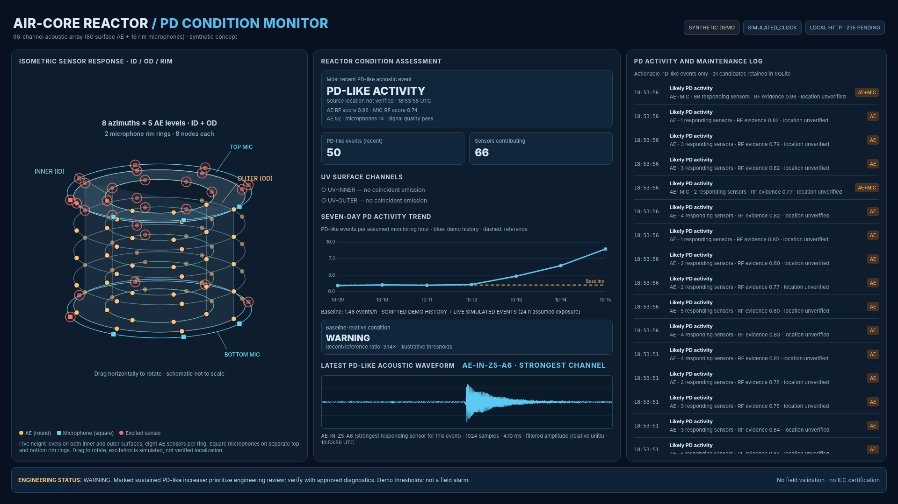

# Air-Core Reactor Partial Discharge Condition Monitor

**An experimental, dual-modality acoustic monitoring and visualization prototype for dry-type air-core reactors.**

This repository explores how contact acoustic-emission (AE) sensors and airborne microphones could support continuous, trend-based detection of **partial-discharge-like (PD-like) activity** in a reactor. It combines synthetic acoustic signal generation, signal processing, Random Forest classification, evidence fusion, event logging, and an interactive operator dashboard.



*HMI captured from the current prototype using synthetic demo data. The seven-day historical baseline is scripted; current events are generated by the simulated detector. All amplitudes and alert thresholds are illustrative.*

## What the prototype does

The application models an acoustic monitoring chain from sensor signals to a condition assessment:

```text
Synthetic reactor acoustic sources
                │
       Acoustic sensor channels
        ┌───────┴────────┐
        │                │
    Contact AE       Airborne MIC
        │                │
  Filtering / candidate-event detection
        │                │
  Signal and temporal feature extraction
        │                │
   AE Random Forest   MIC Random Forest
        └───────┬────────┘
                │
  Conventional signal-quality diagnostics
                │
       Evidence fusion / uncertainty
                │
        Time-stamped SQLite events
                │
     Live HMI + seven-day PD-like trend
```

The two modalities have distinct nominal sampling rates and frequency bands. RF classifiers are trained on **synthetically generated** PD-like and non-PD waveforms; they are not pretrained on a validated field dataset. Conventional diagnostics provide additional signal-quality evidence. A missing microphone detection is not, by itself, proof that a contact-AE detection is invalid.

## Sensor layout and visualization

The proposed visualization contains **96 simulated acoustic channels**:

| Sensor type | Proposed positions | Channels |
| --- | --- | ---: |
| Contact AE, inner bore (ID) | 5 axial levels × 8 azimuths | 40 |
| Contact AE, outer winding surface (OD) | 5 axial levels × 8 azimuths | 40 |
| Airborne microphones, top rim vicinity | 1 ring × 8 azimuths | 8 |
| Airborne microphones, bottom rim vicinity | 1 ring × 8 azimuths | 8 |
| **Total** | | **96** |

The dashboard displays a **short, translucent, hollow reactor cylinder** with thin ID and OD sensor rings. **Circular markers** denote contact AE sensors; **square markers** denote microphones. Drag the reactor horizontally to rotate the view. Sensor markers respond to the synthetic event amplitudes, but their illumination is **not validated source localization**.

No sensors are proposed within intermediate cooling gaps. Microphones are depicted near the top and bottom rims, not necessarily bonded to energized winding material. All physical attachment locations, clearances, dielectric packaging, cable routing, and feasibility remain subject to engineering review and approval.

## Quick start

Requires **Python 3.10+** and a modern desktop browser.

```bash
# Clone the repository
 git clone https://github.com/jimmyxgan/innovation_sprint.git
 cd innovation_sprint

# Optional: create a virtual environment
 python -m venv .venv
 # Windows PowerShell: .venv\Scripts\Activate.ps1
 # macOS/Linux: source .venv/bin/activate

 pip install -r requirements.txt
 python app.py --demo --reset-demo-db --port 8765
```

Open **http://localhost:8765/**.

> **Data warning:** `--reset-demo-db` deletes the local `monitor_v3.sqlite3` database. Use it for a fresh presentation, but omit it when you want to preserve previous runs.

The `--demo` mode seeds an explicitly scripted seven-day baseline and generates synthetic acoustic events on a roughly three-second cadence (plus processing time). The dashboard polls for updated condition and event data. This is **accelerated demonstration activity**, not a calibrated real-world PD occurrence rate.

Other useful commands:

```bash
python app.py --demo --port 8765              # Continue with existing local database
python app.py --port 8765                     # Run without the scripted demo mode
python app.py --demo --period 5 --port 8765   # Change acquisition interval
python app.py --demo --seed-only              # Seed the demo baseline and exit
python app.py --legacy --port 8765            # Use the older AE-only pipeline
python test_integration.py
python test_trends.py
python validate.py
```

## Reading the HMI

The **left panel** shows the 3D isometric sensor layout and the channels responding to the most recent PD-like event. The **center panel** reports the latest condition assessment, the number of responding sensors, the seven-day PD-like event trend, an illustrative baseline comparison, and the waveform from the strongest responding sensor. The **right panel** focuses on actionable PD-like events; non-PD and uncertain candidates are still retained in the database for analysis rather than dominating the operator log.

The seven-day trend combines **scripted historical demo totals** with current simulated detector activity. Its hourly normalization and alert thresholds are illustrative. It must not be interpreted as seven days of independently acquired field measurements or as an IEC-defined alarm limit.

The HMI may show UV-channel status placeholders. **UV corroboration is not implemented as a measured sensor modality** in the current integrated acoustic pipeline.

## Repository structure

| File | Role |
| --- | --- |
| `app.py` | HTTP server, demo acquisition loop, SQLite event storage, API endpoints and status aggregation |
| `dashboard.html` | Interactive isometric HMI, trend chart, waveform and operator event list |
| `integrated_pipeline.py` | Dual-modality channel simulation, classification workflow and event association |
| `sensors.py` | AE and microphone sampling and frequency-band configuration |
| `signal_processing.py` | Modality-specific preprocessing and candidate detection |
| `features.py` | Event-level and temporal acoustic feature extraction |
| `ml_classifier.py` | Random Forest training and inference |
| `conventional.py` | Conventional signal-quality checks |
| `fusion.py` | Combination of classifier and diagnostic evidence |
| `physics.py`, `processing.py` | Original synthetic acoustic model and legacy AE-only processing |
| `outbox_demo.py` | Demonstration of a local event-delivery outbox |
| `test_*.py`, `validate.py` | Regression, integration and validation checks |
| `STANDARDS_MATRIX.md` | Proposed standards mapping and unresolved implementation work |
| `ML_COMPLIANCE.md` | ML evaluation and risk-management verification checklist |
| `assets/hmi-dashboard.png` | Screenshot used in this README |

## Data and validation boundaries

**Implemented in this repository:** synthetic AE/microphone waveforms, preprocessing, RF-based PD-like classification, signal-quality checks, basic evidence fusion, event-level time stamps, local SQLite persistence, a seven-day illustrative trend, and an interactive HMI.

**Not implemented or not established:** calibrated acoustic transfer functions for a specific reactor, field-trained or independently validated classifiers, verified PD source localization, sensitivity in apparent charge (pC), approved physical mounting and routing, hardware-grade synchronized timestamps, operational cybersecurity, IEC 61850 station integration, COMTRADE export, or production monitoring uptime accounting.

In particular, **PD-like** is a classifier output, not a definitive electrical PD diagnosis. The HMI is intended to support review and inspection decisions, not autonomous protection or tripping.

For the intended engineering qualification pathway, see [`STANDARDS_MATRIX.md`](STANDARDS_MATRIX.md) and [`ML_COMPLIANCE.md`](ML_COMPLIANCE.md). The references include **IEC TS 62478** for non-conventional PD measurements, **ISO/IEC TS 4213** for classification performance assessment, and **ISO/IEC 23894** for AI risk management. These are design and verification references, **not claims of certification**.

## Project status

**Research and presentation prototype — synthetic demonstration only.** The next technical milestones are physically credible propagation/transfer models, approved sensor placement, independent PD/non-PD experimental recordings, held-out validation, calibration, and secure integration into an operational monitoring system.
